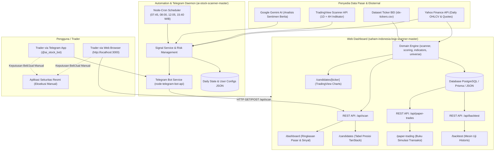

# Arsitektur Sistem & Standar Pengembangan — AI Stock Scanner Ecosystem

Dokumen ini mendefinisikan arsitektur sistem terpadu untuk ekosistem **AI Stock Scanner & BSJP Dashboard**, yang mengintegrasikan Web Dashboard (*Next.js 16*), API Scanner Lokal, Mesin Simulasi Paper Trading & Backtesting, serta Daemon Notifikasi Telegram Otomatis (*Node.js + Cron*).

---

## 🏛️ 1. Diagram Arsitektur Terpadu (Ecosystem Architecture)

Sistem bekerja secara terintegrasi dengan pembagian tanggung jawab yang jelas antar komponen:



---

## 🏗️ 2. Pola Arsitektur Subsistem

### A. Subsistem 1: Web Dashboard (`saham-indonesia-bsjp-scanner-master`)
Dibangun di atas **Next.js 16 (App Router)** dan **React 19**:
```text
saham-indonesia-bsjp-scanner-master/
├── app/
│   ├── dashboard/page.tsx         # Dashboard ringkasan IHSG & top kandidat
│   ├── candidates/page.tsx        # Filterable table kandidat dengan skor detail
│   ├── candidates/[ticker]/page.tsx # Chart interaktif Lightweight Charts & OHLCV
│   ├── paper-trading/page.tsx     # Buku catatan paper trading & kalkulasi PnL
│   ├── backtest/page.tsx          # Konfigurasi pengujian parameter & drawdown
│   ├── settings/page.tsx          # Konfigurasi universe, fee, dan ambang batas skor
│   └── api/
│       ├── scan/route.ts          # Endpoint pemindaian pasar live & histori scan
│       ├── paper-trades/route.ts  # Endpoint pencatatan transaksi virtual
│       └── backtest/route.ts      # Endpoint simulasi pengujian historis
├── components/
│   ├── app-shell.tsx              # Tata letak navigasi terminal (sidebar/header)
│   ├── candidate-table.tsx        # Tabel data TanStack dengan perataan angka tabular
│   ├── price-history-chart.tsx    # Komponen canvas TradingView Lightweight Charts
│   ├── paper-trade-form.tsx       # Modal form kalkulasi lot & risk sizing
│   └── scan-controls.tsx          # Tombol trigger scan cepat & status progress
├── modules/
│   ├── scanner.ts                 # Koordinasi batching pemindaian saham
│   ├── scoring.ts                 # Algoritma multi-faktor BSJP (0-100 poin)
│   ├── indicators.ts              # Perhitungan MA20, MA50, ATR-14, volume ratio
│   ├── market-data.ts             # Integrasi provider Yahoo Finance (yahoo-finance2)
│   ├── trading.ts                 # Logika fee broker, pajak, dan net return
│   └── universe.ts                # Pembacaan semesta saham (CSV, LQ45, IDX30)
└── lib/
    ├── types.ts                   # Definisi antarmuka TypeScript terpusat
    ├── db.ts                      # Koneksi database PostgreSQL / Prisma
    └── format.ts                  # Format mata uang Rupiah dan angka persentase
```

### B. Subsistem 2: Daemon & Telegram Automation (`ai-stock-scanner-master`)
Layanan background mandiri berbasis **Node.js** yang bertugas menjaga disiplin waktu dan distribusi sinyal:
```text
ai-stock-scanner-master/
├── src/
│   ├── index.ts                   # Entry point inisialisasi bot dan cron scheduler
│   ├── config/index.ts            # Konfigurasi environment (Capital, Bot Token, Limits)
│   ├── scheduler/
│   │   ├── cronJobs.ts            # Jadwal scan 07:45, 08:00, 12:05, 15:40 WIB
│   │   └── dailyStateService.ts   # Pelacakan batas sinyal per hari & konfigurasi per user
│   ├── telegram/
│   │   └── telegramService.ts     # Penanganan perintah bot (/start, /menu, inline buttons)
│   ├── services/
│   │   ├── signalService.ts       # Kalkulasi sinyal swing trading & scoring 100 poin
│   │   ├── dataService.ts         # Integrasi API TradingView & Yahoo Finance
│   │   ├── newsService.ts         # Pengambilan berita Yahoo & analisis sentimen Gemini
│   │   └── geminiService.ts       # Integrasi LLM Google Gemini untuk ringkasan emiten
│   └── utils/
│       ├── riskManagement.ts      # Kalkulasi lot size berbasis risiko modal 2%
│       └── logger.ts              # Logging terstruktur dengan format tanggal WIB
└── dailyState.json, userConfigs.json # Penyimpanan state lokal
```

---

## 🔄 3. Alur Komunikasi Dua Arah (Sinergi Web & Telegram)

Salah satu keunggulan arsitektur ini adalah **sinergi langsung antara Bot Telegram dan Dashboard Website**:
1. Saat pengguna menekan tombol *"🔍 Scan BSJP Sore"* pada Telegram:
   - Bot mengirimkan permintaan HTTP `POST http://localhost:3000/api/scan`.
   - Engine Website mengeksekusi pemindaian live dan memperbarui database lokal.
   - Bot mengambil hasil JSON dari `http://localhost:3000/api/scan`, menyusun format pesan Telegram yang rapi, dan menampilkannya langsung ke ponsel pengguna lengkap dengan Target Price (+1.5%) dan Stop Loss (-1.5%).
2. Trader dapat membuka web browser di [http://localhost:3000](http://localhost:3000) untuk meneliti grafik candlestick lebih dalam, mengamati orderbook/history, atau memasukkan transaksi ke buku *Paper Trading*.

---

## 🛡️ 4. Prinsip Integritas Manual Trading (Safety Guardrail)

* **Arsitektur Zero-Execution**:
  - Sistem sengaja **tidak menyediakan integrasi API jual/beli ke sekuritas**.
  - Hal ini menjamin bahwa kegagalan koneksi data, lonjakan volatilitas pasar tiba-tiba, atau bug algoritma **tidak akan pernah** mengeksekusi transaksi uang riil tanpa izin manusia.
  - Pengguna tetap memegang kendali penuh atas keputusan finansial.
