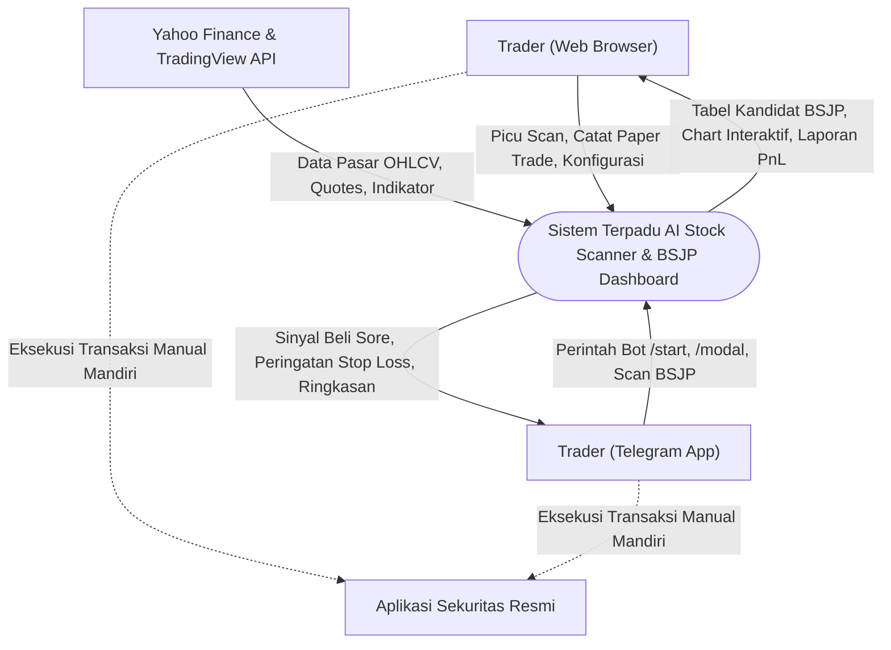
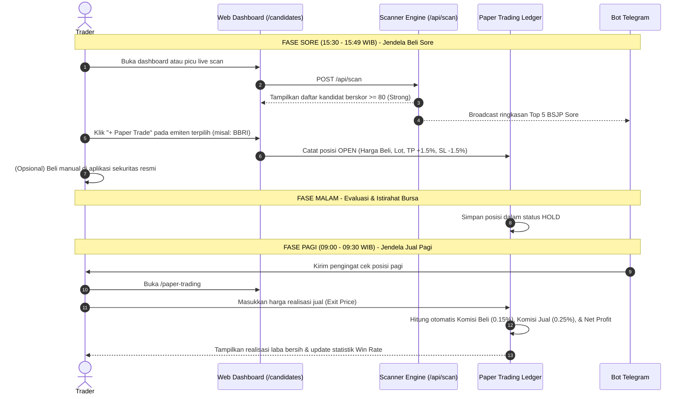
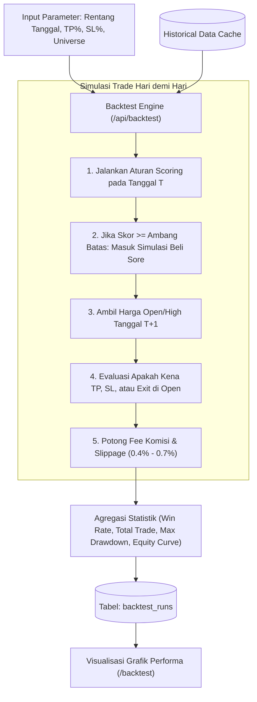

# Diagram Alur Data Sistem (Data Flow Diagrams / DFD) — Stock Scanner Ecosystem

Dokumen ini memodelkan aliran data (*Data Flow Diagrams*) dan alur kerja analitis dari ekosistem **AI Stock Scanner & BSJP Dashboard**.

---

## 🌊 1. Diagram Konteks (DFD Level 0)

Diagram konteks memperlihatkan interaksi antara entitas eksternal dengan sistem terpadu:



---

## ⚙️ 2. DFD Level 1: Proses Pemindaian & Penilaian Saham (BSJP Engine)

Menjelaskan transformasi data dari daftar mentah ticker menjadi kandidat berskor tinggi:

```mermaid
graph TD
    D1[("File Ticker: data/universe/idx-tickers.csv")]
    D2[("Cache Data Pasar: Yahoo Finance API")]
    D3[("Tabel: scan_results")]
    
    P1["1.0 Filter Semesta Saham (Universe Filter)"]
    P2["2.0 Pengambilan Data Pasar Bertahap (Batch Fetcher)"]
    P3["3.0 Kalkulasi Indikator Teknikal (Indicators Engine)"]
    P4["4.0 Penilaian Skor Multi-Faktor (BSJP Scoring)"]
    P5["5.0 Filter & Klasifikasi Sinyal (Ranking & Tagging)"]
    P6["6.0 Distribusi Output (Web Table & Telegram Alert)"]

    D1 -->|Daftar 750+ Saham IDX| P1
    P1 -->|Ticker Terpilih (LQ45 / All IDX)| P2
    P2 <-->|Request/Response Candle OHLCV| D2
    P2 -->|Deret Candle Harian & Volume| P3
    P3 -->|MA20, MA50, ATR-14, Volume Ratio, Close Position| P4
    P4 -->|Skor Mentah & Penalti Risiko| P5
    P5 -->|Kandidat Terurut (Strong, Watchlist, Speculative)| D3
    D3 --> P6
    P6 -->|JSON Payload| WebTable["Tabel /candidates"]
    P6 -->|Pesan Markdown| BotAlert["Notifikasi Telegram"]
```

---

## 🕒 3. Diagram Siklus Hidup Transaksi BSJP (Sore ke Pagi)

Menggambarkan alur eksekusi strategi dari sore hari menjelang penutupan hingga pagi hari pembukaan bursa:



---

## 📊 4. DFD Level 2: Mesin Pengujian Historis (Backtest Engine)

Alur kerja evaluasi strategi terhadap rentang tanggal masa lalu:


